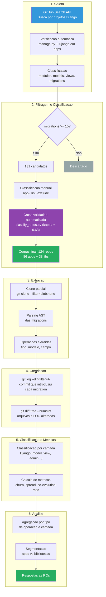
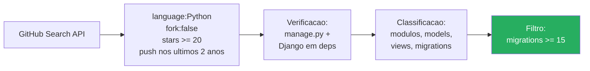
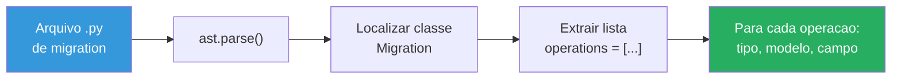
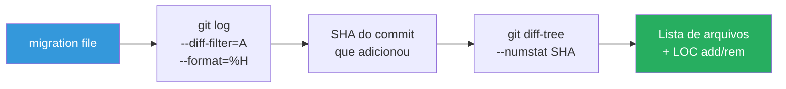
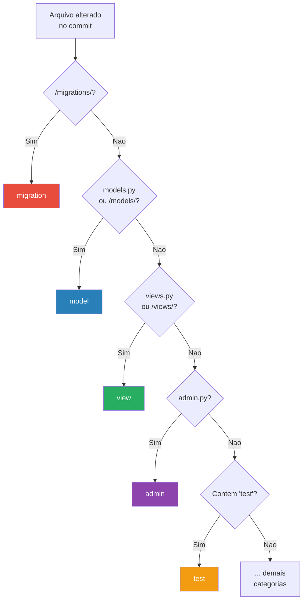

# 4 Metodologia

Este capítulo descreve a metodologia adotada para investigar a co-evolução entre schema e código em projetos Django open-source. O estudo segue uma abordagem empírica quantitativa baseada em Mineração de Repositórios de Software (MSR). A Seção 4.1 apresenta uma visão geral da pipeline de análise. A Seção 4.2 detalha o processo de seleção do corpus. A Seção 4.3 descreve a extração de dados. A Seção 4.4 define as métricas utilizadas. A Seção 4.5 discute as ameaças à validade.

---

## 4.1 Visão Geral

A pipeline de análise é composta por seis etapas sequenciais: (1) coleta de candidatos via GitHub Search API, (2) filtragem e classificação do corpus, (3) extração de operações de migration via parsing AST, (4) correlação de cada migration ao commit que a introduziu via Git, (5) classificação dos arquivos co-modificados por camada arquitetural Django e cálculo de métricas, e (6) análise agregada por tipo de operação, camada e grupo de projeto. A Figura 1 ilustra essa pipeline.

A pipeline é implementada por quatro scripts Python, cada um responsável por uma ou mais etapas. A Tabela 1 resume a correspondência entre etapas, scripts e artefatos produzidos.

| Etapa | Script | Entrada | Saída |
|-------|--------|---------|-------|
| Coleta + Filtragem | `mine_repositories_full.py` | GitHub Search API | `candidates_full.csv` |
| Classificação | `classify_repos.py` | `candidates_full.json` + GitHub API | `corpus_classification_auto.json` |
| Extração | `extract_migrations.py` | Repositórios clonados | `migrations.json` |
| Correlação + Métricas | `analyze_coevolution.py` | Repositórios clonados | `coevolution.json` |

Todos os scripts estão disponíveis no repositório do projeto e podem ser executados de forma independente ou sequencial, garantindo a reprodutibilidade dos resultados.

---

## 4.2 Seleção do Corpus

### 4.2.1 Critérios de inclusão

A seleção dos repositórios que compõem o corpus do estudo seguiu um processo de filtragem progressiva com critérios objetivos e verificáveis. A Figura 2 ilustra o funil de seleção.

Para ser incluído no corpus, um repositório deve satisfazer simultaneamente os seguintes critérios: (1) ser um projeto Django real, verificado pela presença de `manage.py` e de Django como dependência em `requirements.txt` ou `pyproject.toml`; (2) ter Python como linguagem principal; (3) não ser um fork; (4) ter recebido push nos últimos dois anos, indicando atividade recente; (5) ter pelo menos 20 estrelas no GitHub, como proxy de relevância e uso da comunidade; (6) conter pelo menos 15 arquivos de migration, assegurando histórico suficiente de evolução de schema; e (7) possuir pelo menos uma app Django com migrations.

O limiar de 15 migrations foi escolhido para garantir que o repositório possua histórico suficiente de evolução de schema para análise estatística significativa, filtrando projetos com schema trivial ou estático.

### 4.2.2 Processo de mineração

A coleta foi realizada por meio da GitHub Search API, utilizando a infraestrutura adaptada do projeto STAR-RG/django-smells. O processo de mineração passou por duas iterações. A primeira versão (v1) utilizava uma estratégia de bucket-filling que parava ao preencher quotas de tamanho (Small/Medium/Large), avaliando apenas 300 candidatos em 3 páginas de resultados e identificando 17 repositórios elegíveis. Essa estratégia revelou-se insuficiente: a parada antecipada causava perda sistemática de repositórios com muitas migrations nas páginas posteriores.

A segunda versão (v2) adotou uma estratégia de full-scan sem parada antecipada, avaliando todas as 10 páginas de resultados (1.000 candidatos). Essa mudança resultou em um ganho de 7,7 vezes no tamanho do corpus: de 17 para 131 repositórios com 15 ou mais migrations. A v2 também incorporou retry com exponential backoff para lidar com erros de conexão da API do GitHub.

### 4.2.3 Classificação por natureza

Os 131 repositórios elegíveis foram classificados manualmente por sua natureza em três categorias: aplicação full-stack (app), biblioteca reutilizável (lib) ou projeto excluído (exclude). A classificação considerou o nome e descrição do repositório, o propósito do projeto, a presença de views, templates e admin (indicativos de aplicação completa versus componente reutilizável) e o padrão de uso (instalação via pip versus deploy independente).

Sete repositórios foram excluídos por serem projetos didáticos, demos ou tutoriais cujas migrations não representam evolução orgânica de schema. O corpus final contém 124 repositórios: 86 aplicações full-stack e 38 bibliotecas reutilizáveis, totalizando 11.855 migrations.

### 4.2.4 Validação da classificação

Para reforçar a reprodutibilidade da classificação manual, foi implementado um classificador heurístico automatizado (`classify_repos.py`) com 9 regras baseadas em sinais estruturais do repositório: presença de artefatos de packaging (setup.py, pyproject.toml com build-system), artefatos de deploy (Dockerfile, Procfile), contagem de templates HTML, presença de `manage.py` na raiz, publicação no PyPI e keywords no nome do repositório.

A cross-validation entre a classificação manual e a automatizada obteve concordância de 82,4% (108 de 131 repositórios) e Cohen's kappa de 0,63, interpretado como concordância substancial segundo a escala de Landis e Koch (1977). Os 23 desacordos concentram-se em dois padrões estruturais explicáveis: bibliotecas com muitos templates (como django-allauth com 139 templates) que o classificador automatizado identifica como apps, e aplicações distribuídas como pacotes pip (como modoboa, sem `manage.py` na raiz) que o classificador identifica como libs. Esses desacordos refletem ambiguidades inerentes ao ecossistema Django, não inconsistência da classificação humana.

---

## 4.3 Extração de Dados

### 4.3.1 Extração de operações de migration

Cada repositório do corpus é clonado parcialmente com `git clone --filter=blob:none`, que preserva todo o histórico de commits sem baixar todos os blobs antecipadamente, economizando banda e espaço em disco.

As operações de migration são extraídas via parsing da Abstract Syntax Tree (AST) do Python. O parser localiza, em cada arquivo de migration, a classe que herda de `migrations.Migration`, acessa o atributo `operations` e extrai, para cada operação, seu tipo (CreateModel, AddField, etc.), o modelo afetado e o campo quando aplicável. A Figura 3 ilustra esse processo.

As operações extraídas são agrupadas em cinco categorias, conforme a Tabela 2.

| Categoria | Operações |
|-----------|-----------|
| Ciclo de vida do modelo | CreateModel, DeleteModel |
| Mudanças de campo | AddField, RemoveField, AlterField, RenameField |
| Índices e constraints | AddIndex, RemoveIndex, AddConstraint, RemoveConstraint |
| Metadados do modelo | AlterModelOptions, AlterModelTable, RenameModel, AlterUniqueTogether, AlterIndexTogether |
| Customizadas | RunSQL, RunPython, SeparateDatabaseAndState |

Essa abordagem via AST é mais confiável do que a extração de SQL embutido utilizada em estudos anteriores (QIU; LI; SU, 2013), pois explora a estrutura canônica e padronizada das migrations Django, eliminando ambiguidades de parsing textual.

### 4.3.2 Correlação migration-commit

Para cada migration extraída, o commit que a introduziu no repositório é identificado por meio do comando `git log --diff-filter=A --format=%H -- <migration_path>`, que retorna o SHA do commit que adicionou o arquivo. Em seguida, `git diff-tree --numstat <SHA>` lista todos os arquivos alterados nesse commit, juntamente com o número de linhas adicionadas e removidas em cada arquivo. A Figura 4 ilustra essa associação.

A definição operacional de co-evolução adotada neste estudo é a de same-commit co-evolution: uma migration e o código da aplicação são considerados co-evoluídos quando ambos são modificados no mesmo commit que introduziu a migration. Essa é a definição mais simples e reprodutível entre as alternativas possíveis, como discutido na Seção 4.5.

### 4.3.3 Classificação de arquivos por camada

Cada arquivo alterado no commit é classificado por seu papel na arquitetura Django, com base em padrões de nomenclatura e caminho de diretório. A Tabela 3 apresenta os critérios de classificação e a Figura 5 ilustra a árvore de decisão.

| Categoria | Critério |
|-----------|----------|
| migration | Dentro de `/migrations/` |
| model | `models.py` ou dentro de `/models/` |
| view | `views.py` ou dentro de `/views/` |
| serializer | `serializers.py` ou dentro de `/serializers/` |
| form | `forms.py` ou dentro de `/forms/` |
| admin | `admin.py` |
| test | Contém 'test' no caminho |
| url | `urls.py` |
| template | Arquivo `.html` |
| other_python | Outros arquivos `.py` |
| other | Demais arquivos |

Essa classificação heurística segue convenções amplamente adotadas no ecossistema Django. Embora possa haver ambiguidades em casos específicos (por exemplo, um arquivo `admin_views.py` seria classificado como view, não como admin), esses casos são raros e a abordagem é consistente e reprodutível.

---

## 4.4 Métricas

As métricas utilizadas neste estudo foram definidas para responder às três perguntas de pesquisa. A Tabela 4 resume cada métrica, sua descrição e a pergunta de pesquisa que ela endereça.

| Métrica | Descrição | RQ |
|---------|-----------|-----|
| **Co-evolution ratio** | Proporção de commits que introduzem migrations e que também alteram pelo menos um arquivo de código fora do diretório de migrations | RQ1 |
| **Code churn** | Total de linhas adicionadas e removidas nos arquivos de código (excluindo as próprias migrations) em cada commit de migration | RQ1, RQ2 |
| **Spread** | Número de arquivos de código distintos alterados por commit de migration | RQ1, RQ2 |
| **Category distribution** | Frequência com que cada camada arquitetural Django aparece nos commits de migration | RQ2 |
| **Operation type distribution** | Frequência e impacto (churn, spread) de cada tipo de operação de migration | RQ2 |
| **Group comparison** | Todas as métricas acima segmentadas por grupo: aplicações full-stack versus bibliotecas reutilizáveis | RQ3 |

O **co-evolution ratio** é a métrica central para a RQ1. Um valor alto indica que desenvolvedores tipicamente adaptam o código da aplicação no mesmo commit em que introduzem a migration, sugerindo forte acoplamento entre schema e código. Um valor baixo pode indicar que as adaptações ocorrem em commits posteriores (acoplamento temporal fraco) ou que a mudança de schema não exige adaptações no código (acoplamento estrutural fraco).

O **spread** e o **code churn** complementam o co-evolution ratio ao medir a amplitude do impacto: quantos arquivos são afetados e quanto código é modificado quando uma mudança de schema é introduzida.

A **category distribution** é central para a RQ2. Ao cruzar a camada afetada com o tipo de operação de migration, é possível identificar padrões de propagação — por exemplo, se operações de CreateModel tipicamente co-modificam mais camadas do que operações de AddField.

---

## 4.5 Ameaças à Validade

### 4.5.1 Validade de construto

A principal ameaça à validade de construto é a definição de co-evolução como same-commit. Essa definição pode superestimar o acoplamento quando um commit contém mudanças não relacionadas à migration (kitchen-sink commits), ou subestimá-lo quando o código é adaptado em commits posteriores. Para mitigar a primeira ameaça, o estudo oferece a opção de filtrar commits com mais de 50 arquivos alterados (flag `--max-commit-files`). A segunda ameaça é discutida como limitação explícita: a definição same-commit fornece um limite inferior conservador do grau real de co-evolução.

### 4.5.2 Validade interna

A classificação de arquivos por camada é baseada em heurísticas de nomenclatura. Projetos que não seguem as convenções padrão do Django podem ser classificados incorretamente. No entanto, as convenções utilizadas são amplamente adotadas e recomendadas pela documentação oficial do Django, minimizando esse risco.

A causalidade entre migration e código é assumida, não verificada: o fato de um arquivo de código ser alterado no mesmo commit que uma migration não prova que a alteração foi motivada pela mudança de schema. Essa é uma limitação inerente à abordagem de same-commit co-evolution, compartilhada com estudos anteriores (QIU; LI; SU, 2013).

### 4.5.3 Validade externa

O corpus é composto exclusivamente por projetos Django open-source hospedados no GitHub, o que pode não ser representativo de software industrial ou de projetos que utilizam outros frameworks ORM. Os critérios de seleção (mínimo de 20 estrelas e 15 migrations) introduzem um viés em favor de projetos mais populares e com histórico mais longo, excluindo projetos pequenos ou recém-criados. Essas limitações são consistentes com as de estudos anteriores na área (KALLIAMVAKOU et al., 2014) e são inerentes à abordagem de MSR baseada em repositórios públicos.

### 4.5.4 Confiabilidade

A classificação manual dos repositórios em apps e libs foi realizada por um único classificador (o autor deste trabalho) e validada por um classificador heurístico automatizado com concordância substancial (kappa = 0,63). Todos os scripts da pipeline são open-source e disponíveis no repositório do projeto, permitindo reprodução independente dos resultados.
