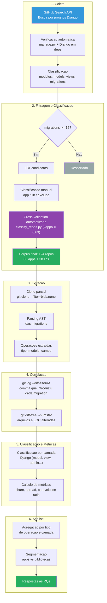
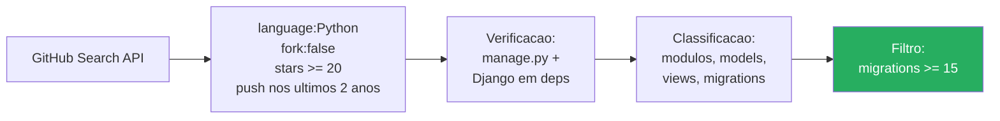
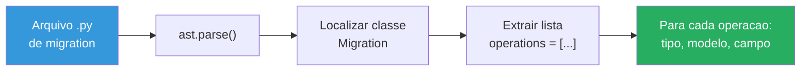
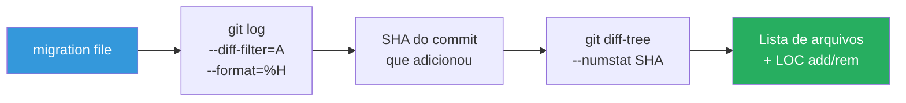
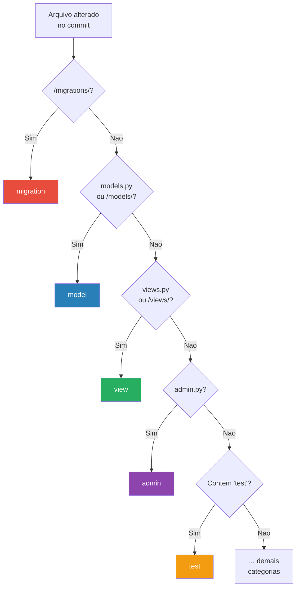

# UNIVERSIDADE FEDERAL DE PERNAMBUCO
# CENTRO DE INFORMÁTICA
# GRADUAÇÃO EM CIÊNCIA DA COMPUTAÇÃO

---

GABRIEL ROCHA SOUZA SILVA

---

# **Co-evolução entre Schema e Código de aplicação em projetos Django open-source: um estudo empírico baseado em mineração de repositórios**

---

Trabalho de Conclusão de Curso apresentado ao Curso de Ciência da Computação da Universidade Federal de Pernambuco, como requisito parcial para obtenção do título de Bacharel em Ciência da Computação.

**Orientador:** Leopoldo Motta Teixeira

Recife
2026

---

<!-- FOLHA DE APROVAÇÃO -->

GABRIEL ROCHA SOUZA SILVA

**Co-evolução entre Schema e Código de aplicação em projetos Django open-source: um estudo empírico baseado em mineração de repositórios**

Trabalho de Conclusão de Curso apresentado ao Curso de Ciência da Computação da Universidade Federal de Pernambuco, como requisito parcial para obtenção do título de Bacharel em Ciência da Computação.

Aprovado em: ___/___/2026

BANCA EXAMINADORA

_______________________________________________
Leopoldo Motta Teixeira (Orientador)
Universidade Federal de Pernambuco

_______________________________________________
[Examinador(a)]
Universidade Federal de Pernambuco

_______________________________________________
[Examinador(a)]
[Universidade]

---

<!-- FICHA CATALOGRÁFICA: gerar em https://fichaeletronica.ufpe.br/ficha.html -->

---


---


# RESUMO

Sistemas de software que utilizam bancos de dados relacionais dependem de um esquema cuja evolução frequentemente exige adaptações coordenadas no código da aplicação. No ecossistema Django, essa evolução é formalizada por meio de migrations — arquivos Python que descrevem operações de schema de forma estruturada e rastreável. Apesar da relevância dessa coordenação para a manutenção de software, poucos estudos investigaram empiricamente como mudanças de schema propagam pelas camadas arquiteturais do código em projetos que utilizam ORM. Este trabalho apresenta um estudo empírico quantitativo baseado em Mineração de Repositórios de Software, analisando 11.624 pares migration-commit extraídos de 124 projetos Django open-source (86 aplicações e 38 bibliotecas) que totalizam 34.345 operações de schema. Os resultados revelam que a co-evolução schema-código é a norma no ecossistema Django: 82,7% dos commits que introduzem migrations também alteram código da aplicação (mediana per-repo de 90,3%). A análise por camada arquitetural mostra que testes (16,3%) e arquivos Python auxiliares (21,1%) são mais frequentemente co-modificados do que views (5,4%) ou admin (1,7%), e que operações destrutivas (DeleteModel, RemoveField) co-evoluem mais fortemente com testes do que operações aditivas. Contrariamente à hipótese inicial, bibliotecas reutilizáveis apresentam co-evolution ratio mais alto (91,6%) do que aplicações full-stack (81,8%), com proporção de testes co-modificados quase duas vezes maior. O estudo contribui com a primeira caracterização empírica de co-evolução schema-código no ecossistema Django, uma análise inédita por camada arquitetural cruzada com tipo de operação, e uma pipeline reprodutível de scripts open-source.

**Palavras-chave:** co-evolução; evolução de schema; Django; migrations; mineração de repositórios de software.

---

# ABSTRACT

Software systems that rely on relational databases depend on a schema whose evolution frequently requires coordinated changes to the application code. In the Django ecosystem, this evolution is formalized through migrations — Python files that describe schema operations in a structured and traceable manner. Despite the relevance of this coordination for software maintenance, few studies have empirically investigated how schema changes propagate across the architectural layers of code in projects that use ORM. This work presents a quantitative empirical study based on Mining Software Repositories, analyzing 11,624 migration-commit pairs extracted from 124 open-source Django projects (86 applications and 38 libraries) totaling 34,345 schema operations. Results reveal that schema-code co-evolution is the norm in the Django ecosystem: 82.7% of commits that introduce migrations also modify application code (per-repo median of 90.3%). The layer-level analysis shows that tests (16.3%) and auxiliary Python files (21.1%) are more frequently co-modified than views (5.4%) or admin (1.7%), and that destructive operations (DeleteModel, RemoveField) co-evolve more strongly with tests than additive operations. Contrary to the initial hypothesis, reusable libraries exhibit a higher co-evolution ratio (91.6%) than full-stack applications (81.8%), with a nearly doubled proportion of co-modified tests. The study contributes the first empirical characterization of schema-code co-evolution in the Django ecosystem, a novel layer-level analysis crossed with operation type, and a reproducible open-source pipeline.

**Keywords:** co-evolution; schema evolution; Django; migrations; mining software repositories.


---

<!-- SUMÁRIO: gerar automaticamente no Word/LaTeX -->

---


# 1 Introdução

Sistemas de software que utilizam bancos de dados relacionais dependem de um esquema (schema) que define a estrutura das tabelas, colunas, tipos de dados e restrições de integridade. Esse esquema não é estático: ao longo do ciclo de vida de uma aplicação, mudanças nos requisitos de negócio, correções de defeitos e otimizações de desempenho frequentemente exigem alterações na estrutura do banco de dados. Quando o schema muda — novas tabelas são criadas, campos são adicionados, colunas são removidas — o código da aplicação que interage com esses dados frequentemente precisa ser adaptado para refletir a nova estrutura. Esse fenômeno de modificação coordenada entre a estrutura do banco de dados e o código que a utiliza é denominado co-evolução schema-código (QIU; LI; SU, 2013).

A co-evolução schema-código é um problema relevante para a manutenção de software. Estudos anteriores demonstraram que a falta de sincronização entre mudanças de schema e adaptações no código é uma fonte significativa de defeitos em aplicações de banco de dados (MEURICE; NAGY; CLEVE, 2016). Quando um desenvolvedor modifica o schema sem atualizar todas as partes do código que dependem da estrutura anterior, o resultado pode ser erros em tempo de execução, perda de dados ou comportamento incorreto da aplicação. Liu, Mondal e Chen (2024) constataram que bugs relacionados a schema, consultas SQL e APIs de acesso a dados representam 84,2% dos defeitos de acesso a banco de dados em aplicações Java de grande porte.

Apesar da relevância desse problema, a literatura existente sobre co-evolução schema-código apresenta lacunas importantes. Os estudos empíricos de maior escala (QIU; LI; SU, 2013; VASSILIADIS et al., 2023) focaram predominantemente em sistemas que utilizam SQL explicitamente embutido no código-fonte, onde as consultas são escritas como strings dentro de classes Java via JDBC. Pouco se sabe sobre como a co-evolução se manifesta em frameworks que adotam o padrão ORM (Object-Relational Mapping), nos quais a interação com o banco de dados é mediada por uma camada de abstração e as mudanças de schema são formalizadas por mecanismos específicos do framework.

O ecossistema Django, um dos frameworks de desenvolvimento web mais adotados na linguagem Python, representa uma oportunidade particularmente favorável para o estudo empírico de co-evolução schema-código. Desde a versão 1.7, o Django disponibiliza um sistema de migrations: arquivos Python gerados automaticamente a partir de alterações nas definições de modelo (`models.py`) que descrevem, de forma estruturada e tipada, as operações de evolução do schema relacional. Essa padronização confere três propriedades que viabilizam a análise sistemática em larga escala. Primeiro, as mudanças de schema são rastreáveis como arquivos versionados no sistema de controle de versão (Git), o que permite associar cada migration ao commit que a introduziu. Segundo, as operações de schema são estruturadas e passíveis de extração automatizada via parsing da Abstract Syntax Tree (AST) do Python, sem necessidade de executar o código ou instalar dependências do projeto. Terceiro, o fluxo causal é bem definido: o desenvolvedor altera `models.py`, o comando `makemigrations` gera a migration, e o commit registra ambas as mudanças junto com eventuais adaptações no restante do código.

Além disso, a arquitetura do Django organiza o código da aplicação em camadas com responsabilidades bem definidas — models, views, admin, serializers, forms, templates, URLs e testes — cada uma com um grau distinto de acoplamento com o schema do banco de dados. Essa separação arquitetural permite uma análise mais granular do que a oferecida por estudos anteriores, que trataram o código da aplicação como uma massa homogênea: é possível identificar não apenas se o código foi co-modificado com o schema, mas especificamente quais camadas da arquitetura foram afetadas.

## 1.1 Objetivo

Este trabalho tem como objetivo investigar empiricamente os padrões de co-evolução entre schema de banco de dados e código de aplicação em projetos Django open-source, utilizando uma abordagem de Mineração de Repositórios de Software (MSR). Especificamente, o estudo busca caracterizar o grau de acoplamento entre mudanças de schema e mudanças no código, mapear como essas mudanças propagam pelas camadas da arquitetura Django e verificar se a natureza do projeto (aplicação full-stack versus biblioteca reutilizável) influencia os padrões observados.

## 1.2 Perguntas de Pesquisa

Três perguntas de pesquisa guiam a investigação, construindo uma narrativa progressiva que parte da quantificação do fenômeno, avança para sua decomposição por camada e tipo de operação, e conclui com a análise de fatores que podem explicar variações nos padrões observados:

**RQ1: Qual o grau de acoplamento entre mudanças de schema e mudanças no código de aplicação nos commits de projetos Django open-source?**

Esta pergunta mede o co-evolution ratio — a proporção de commits que introduzem migrations e que também alteram arquivos de código fora do diretório de migrations. A hipótese é que a maioria dos commits com migration também altera `models.py` (pois `makemigrations` parte de mudanças no modelo), mas uma parcela relevante não alcança camadas downstream como views, admin e testes, indicando acoplamento parcial.

**RQ2: Quais camadas da arquitetura Django são mais frequentemente co-modificadas em resposta a evoluções de schema, e como essa distribuição se relaciona com o tipo de operação de migration realizada?**

Esta pergunta cruza duas dimensões: a camada arquitetural afetada (model, view, admin, serializer, form, template, test, URL) e o tipo de operação de migration (CreateModel, AddField, RemoveField, AlterField, entre outros). A hipótese é que operações de ciclo de vida do modelo (CreateModel, DeleteModel) afetam mais camadas do que operações pontuais de campo (AddField, AlterField), pois a criação de um novo modelo frequentemente demanda views, URLs, admin e testes correspondentes.

**RQ3: Os padrões de co-evolução observados diferem entre aplicações Django full-stack e bibliotecas reutilizáveis?**

Esta pergunta compara as métricas de RQ1 e RQ2 entre dois grupos: aplicações full-stack (que possuem o ciclo completo de models, views, templates e admin) e bibliotecas reutilizáveis (que expõem models mas cujo código downstream reside em projetos de terceiros). A hipótese é que bibliotecas apresentam co-evolution ratio menor, pois mudanças de schema em libs propagam para código fora do repositório analisado.

## 1.3 Contribuições

Este trabalho oferece quatro contribuições:

1. **Caracterização empírica do acoplamento schema-código em Django.** Quantificação do co-evolution ratio, code churn e spread em 124 projetos Django open-source, fornecendo o primeiro retrato empírico desse fenômeno no ecossistema Django.

2. **Mapeamento da propagação por camada arquitetural.** Identificação de quais camadas da arquitetura Django (model, view, admin, serializer, form, template, test, URL) são mais frequentemente afetadas por mudanças de schema, cruzada com o tipo de operação de migration — uma dimensão de análise inédita na literatura.

3. **Comparação entre aplicações e bibliotecas.** Segmentação do corpus em 86 aplicações full-stack e 38 bibliotecas reutilizáveis para investigar se a natureza do projeto influencia os padrões de co-evolução — uma questão não explorada em trabalhos anteriores.

4. **Pipeline reprodutível.** Disponibilização de scripts open-source para mineração de repositórios Django, extração de operações de migration via AST e análise de co-evolução, permitindo reprodução e extensão dos resultados.

## 1.4 Estrutura do Documento

O restante deste documento está organizado da seguinte forma. A Seção 2 apresenta a fundamentação teórica, cobrindo evolução de schema, o sistema de migrations do Django, Mineração de Repositórios de Software e o conceito de co-evolução schema-código. A Seção 3 revisa os trabalhos relacionados e posiciona este estudo em relação à literatura existente. A Seção 4 detalha a metodologia, incluindo o processo de seleção do corpus, a pipeline de extração e análise, e as métricas utilizadas. A Seção 5 apresenta os resultados obtidos para cada pergunta de pesquisa. Por fim, a Seção 6 discute as conclusões, limitações e direções para trabalhos futuros.


---


# 2 Fundamentação Teórica

Este capítulo apresenta os conceitos fundamentais que sustentam a investigação proposta. A Seção 2.1 discute a evolução de schemas de banco de dados e seus desafios. A Seção 2.2 detalha o framework Django e seu sistema de migrations, que constitui o objeto de análise deste trabalho. A Seção 2.3 introduz a Mineração de Repositórios de Software como abordagem metodológica. Por fim, a Seção 2.4 define co-evolução schema-código e situa o conceito na literatura.

---

## 2.1 Evolução de Schema de Banco de Dados

Sistemas de software que utilizam bancos de dados relacionais dependem de um esquema (schema) que define a estrutura das tabelas, colunas, tipos de dados, restrições de integridade e índices. Esse esquema não é estático: ao longo do ciclo de vida de uma aplicação, mudanças nos requisitos de negócio, correções de bugs e otimizações de desempenho frequentemente exigem alterações na estrutura do banco de dados (RODDICK, 1992).

A evolução de schema refere-se ao processo de modificar o esquema de um banco de dados enquanto se preserva a integridade dos dados existentes e a compatibilidade com o código da aplicação que o utiliza (CURINO; MOON; ZANIOLO, 2008). Esse processo envolve operações como criação e remoção de tabelas, adição e remoção de colunas, alteração de tipos de dados e modificação de restrições de integridade.

A importância da evolução de schema para a engenharia de software reside no fato de que o esquema do banco de dados serve como um contrato implícito entre a camada de persistência e as demais camadas da aplicação. Quando esse contrato é alterado — por exemplo, ao renomear uma coluna ou remover uma tabela — todo o código que depende da estrutura anterior pode ser afetado. Se essas dependências não forem atualizadas de forma coordenada, o resultado são inconsistências que podem se manifestar como erros em tempo de execução, perda de dados ou comportamento incorreto da aplicação (MEURICE; NAGY; CLEVE, 2016).

Curino, Moon e Zaniolo (2008) classificam as operações de evolução de schema em categorias de acordo com seu impacto:

- **Operações aditivas:** criam novos elementos no schema sem afetar os existentes (ex.: adicionar uma nova tabela ou coluna). Essas operações geralmente são retrocompatíveis.
- **Operações destrutivas:** removem elementos do schema (ex.: remover uma coluna ou tabela). Essas operações podem causar inconsistências no código que referenciava os elementos removidos.
- **Operações de modificação:** alteram propriedades de elementos existentes (ex.: mudar o tipo de uma coluna, renomear uma tabela). O impacto depende da natureza da modificação.

Em sistemas tradicionais, a evolução de schema era frequentemente gerenciada por meio de scripts SQL executados manualmente pelos administradores de banco de dados. Essa abordagem é propensa a erros e dificulta a rastreabilidade das mudanças. Frameworks modernos de desenvolvimento web, como Django, Ruby on Rails e Laravel, introduziram sistemas de migrations que formalizam e automatizam esse processo, tornando as mudanças de schema versionáveis e reprodutíveis.

---

## 2.2 Django e o Sistema de Migrations

### 2.2.1 O framework Django

Django é um framework de desenvolvimento web em Python que segue o padrão arquitetural Model-View-Template (MVT), uma variação do Model-View-Controller (MVC). Lançado em 2005 e mantido pela Django Software Foundation, o framework é amplamente adotado tanto em projetos open-source quanto em aplicações comerciais, sendo utilizado por organizações como Mozilla, Instagram e The Washington Post (DJANGO SOFTWARE FOUNDATION, 2024).

A arquitetura de uma aplicação Django é organizada em camadas com responsabilidades bem definidas:

- **Models (`models.py`):** definem a estrutura dos dados como classes Python. Cada classe de modelo corresponde a uma tabela no banco de dados, e cada atributo da classe corresponde a uma coluna. O ORM (Object-Relational Mapping) do Django traduz essas definições declarativas em operações SQL.
- **Views (`views.py`):** contêm a lógica de negócio que processa requisições HTTP e retorna respostas. Views acessam os dados através dos models.
- **Templates (`.html`):** definem a apresentação visual dos dados ao usuário.
- **Admin (`admin.py`):** fornece uma interface administrativa gerada automaticamente para gerenciar os dados dos models.
- **Forms (`forms.py`):** definem a validação e o processamento de formulários, frequentemente vinculados a models específicos.
- **Serializers (`serializers.py`):** utilizados em APIs REST (via Django REST Framework), convertem objetos de modelo em representações JSON e vice-versa.
- **URLs (`urls.py`):** mapeiam URLs para views.

Essa separação em camadas é relevante para este estudo porque cada camada possui um grau diferente de acoplamento com o schema do banco de dados. Models são diretamente vinculados ao schema; views, admin e serializers dependem dos models e, portanto, são indiretamente afetados por mudanças de schema; templates e URLs tipicamente têm acoplamento mais fraco.

### 2.2.2 O sistema de migrations do Django

O sistema de migrations do Django foi introduzido na versão 1.7 (2014) e constitui o mecanismo oficial para gerenciar a evolução do schema de banco de dados. O fluxo de trabalho típico segue três etapas:

1. O desenvolvedor altera as definições em `models.py` (adiciona um campo, cria um modelo, etc.).
2. O comando `python manage.py makemigrations` detecta automaticamente as diferenças entre os models e o estado atual do schema, gerando um arquivo de migration.
3. O comando `python manage.py migrate` aplica as migrations pendentes ao banco de dados.

Cada migration é um arquivo Python com uma estrutura canônica e padronizada:

```python
from django.db import migrations, models

class Migration(migrations.Migration):
    dependencies = [
        ('app_name', '0001_initial'),
    ]
    operations = [
        migrations.AddField(
            model_name='order',
            name='status',
            field=models.CharField(max_length=20, default='pending'),
        ),
    ]
```

A lista `operations` contém as operações de schema a serem aplicadas. O Django define um conjunto finito de tipos de operação, que podem ser agrupados em categorias:

| Categoria | Operações | Descrição |
|-----------|-----------|-----------|
| Ciclo de vida do modelo | `CreateModel`, `DeleteModel` | Criação e remoção de tabelas |
| Mudanças de campo | `AddField`, `RemoveField`, `AlterField`, `RenameField` | Adição, remoção e modificação de colunas |
| Índices e constraints | `AddIndex`, `RemoveIndex`, `AddConstraint`, `RemoveConstraint` | Gerenciamento de índices e restrições |
| Metadados | `AlterModelOptions`, `AlterModelTable`, `RenameModel`, `AlterUniqueTogether`, `AlterIndexTogether` | Propriedades do modelo que não alteram colunas diretamente |
| Customizadas | `RunSQL`, `RunPython`, `SeparateDatabaseAndState` | Operações arbitrárias definidas pelo desenvolvedor |

Essa estrutura padronizada é especialmente relevante para estudos empíricos porque permite a extração automatizada das operações de schema via parsing da Abstract Syntax Tree (AST) do Python, sem necessidade de executar o código ou instalar as dependências do projeto.

### 2.2.3 Migrations como artefatos de evolução de schema

As migrations do Django possuem propriedades que as tornam particularmente adequadas para o estudo de evolução de schema:

1. **Rastreabilidade:** como arquivos versionados no Git, cada migration tem um commit associado que registra quando foi introduzida e quais outros arquivos foram modificados no mesmo contexto.
2. **Parseabilidade:** a estrutura canônica do arquivo de migration permite a extração de operações via AST sem ambiguidade.
3. **Causalidade explícita:** o fluxo `models.py → makemigrations → migration` estabelece uma relação causal clara entre mudanças no modelo e operações de schema.
4. **Granularidade:** cada operação dentro de uma migration corresponde a uma mudança atômica no schema (um campo adicionado, uma tabela criada, etc.).

Essas propriedades distinguem as migrations do Django de abordagens anteriores baseadas em SQL embutido no código, onde a identificação de mudanças de schema exigia análise textual de strings SQL dispersas pelo código-fonte (QIU; LI; SU, 2013).

---

## 2.3 Mineração de Repositórios de Software

Mineração de Repositórios de Software (MSR — Mining Software Repositories) é uma área de pesquisa em engenharia de software que utiliza técnicas de análise de dados para extrair informações úteis dos artefatos produzidos durante o desenvolvimento de software (HASSAN, 2008). Esses artefatos incluem sistemas de controle de versão (como Git), rastreadores de bugs, listas de e-mail, revisões de código e documentação.

O objetivo da MSR é transformar repositórios de software — que são fundamentalmente registros históricos de decisões de desenvolvimento — em fontes de evidência empírica sobre práticas, padrões e problemas de engenharia de software. A área consolidou-se ao longo das últimas duas décadas, com uma conferência dedicada (MSR — Mining Software Repositories) desde 2004 e aplicações em diversas subáreas da engenharia de software.

### 2.3.1 Técnicas utilizadas neste trabalho

Este estudo emprega três técnicas de MSR que são aplicadas de forma combinada:

**Análise de commits via Git.** O histórico de commits de um repositório registra cada modificação feita ao longo do tempo, incluindo quais arquivos foram alterados, quantas linhas foram adicionadas e removidas, e a mensagem associada pelo desenvolvedor. Comandos como `git log --diff-filter=A` permitem identificar o commit que introduziu um arquivo específico (como uma migration), e `git diff-tree --numstat` permite listar todos os arquivos alterados em um dado commit com métricas de churn (linhas adicionadas e removidas).

**Parsing de AST (Abstract Syntax Tree).** A AST é uma representação estruturada do código-fonte que preserva sua semântica sintática. Em Python, o módulo `ast` da biblioteca padrão permite analisar arquivos `.py` e extrair informações estruturadas sem executar o código. No contexto deste trabalho, o parsing de AST é utilizado para extrair as operações de cada migration (tipo de operação, modelo afetado, campo quando aplicável) de forma confiável e automatizada.

**Classificação heurística de arquivos.** Os arquivos alterados em cada commit são classificados por seu papel na arquitetura Django com base em padrões de nomenclatura e caminho. Por exemplo, arquivos em diretórios `/migrations/` são classificados como migrations, arquivos nomeados `models.py` ou dentro de `/models/` são classificados como models, e assim por diante. Essa abordagem segue convenções amplamente adotadas no ecossistema Django.

### 2.3.2 Plataforma GitHub como fonte de dados

O GitHub é a maior plataforma de hospedagem de código-fonte do mundo, com mais de 100 milhões de repositórios públicos. Para estudos de MSR, o GitHub oferece uma API de busca que permite filtrar repositórios por linguagem, número de estrelas, data de atividade e outros critérios, além de APIs para acessar a árvore de arquivos e o conteúdo de repositórios sem necessidade de clone completo.

A utilização de projetos open-source hospedados no GitHub como corpus de estudo é uma prática consolidada na literatura de engenharia de software empírica, embora apresente ameaças à validade conhecidas, como o viés de seleção (projetos no GitHub podem não ser representativos de software industrial) e a presença de projetos inativos, acadêmicos ou de demonstração (KALLIAMVAKOU et al., 2014).

---

## 2.4 Co-evolução Schema-Código

### 2.4.1 Definição

Co-evolução schema-código refere-se ao fenômeno pelo qual mudanças na estrutura do banco de dados (schema) e mudanças no código da aplicação ocorrem de forma coordenada ao longo do tempo. Quando o schema evolui — por exemplo, com a adição de um novo campo em uma tabela — o código que interage com essa tabela frequentemente precisa ser adaptado para refletir a mudança: novos formulários, consultas atualizadas, interfaces administrativas modificadas, testes ajustados.

A coordenação entre schema e código é essencial para a manutenção da consistência do sistema. Qiu, Li e Su (2013) demonstraram que a falta de sincronização entre mudanças de schema e adaptações no código é uma fonte significativa de bugs em aplicações de banco de dados, particularmente em projetos de grande escala onde múltiplos desenvolvedores modificam o schema e o código de forma concorrente.

### 2.4.2 Dimensões da co-evolução

A co-evolução schema-código pode ser analisada sob múltiplas dimensões:

**Acoplamento temporal.** Mede se mudanças de schema e mudanças no código ocorrem no mesmo commit, na mesma janela temporal, ou de forma desacoplada. Um alto grau de acoplamento temporal sugere que os desenvolvedores reconhecem e tratam a dependência entre schema e código como parte de uma mesma unidade lógica de trabalho.

**Amplitude de propagação (spread).** Mede quantos arquivos de código são afetados por uma mudança de schema. Uma mudança que afeta apenas `models.py` tem spread baixo; uma que requer adaptações em views, admin, serializers e testes tem spread alto.

**Profundidade arquitetural.** Identifica quais camadas da arquitetura são afetadas por uma mudança de schema. Em uma aplicação Django, espera-se que `models.py` seja quase sempre co-modificado (pois é a origem causal da migration), mas o grau de propagação para camadas mais distantes (views, templates, testes) pode variar.

**Impacto por tipo de operação.** Diferentes tipos de operação de schema podem ter impactos distintos na aplicação. Intuitivamente, operações de ciclo de vida (como `CreateModel`) devem afetar mais camadas do que operações pontuais (como `AlterField`), pois a criação de um novo modelo frequentemente exige views, URLs, admin e testes correspondentes.

### 2.4.3 Operacionalização neste estudo

Neste trabalho, a co-evolução é operacionalizada da seguinte forma: uma migration e o código da aplicação são considerados co-evoluídos quando ambos são modificados no mesmo commit que introduziu a migration. Essa definição — denominada same-commit co-evolution — é a mais simples e reprodutível entre as alternativas possíveis, embora possua limitações reconhecidas: mudanças no código podem ocorrer em commits posteriores à migration, e commits com muitas alterações não relacionadas (kitchen-sink commits) podem inflar artificialmente as métricas de co-evolução. Essas limitações são discutidas como ameaças à validade na Seção 4.5.

A métrica central derivada dessa operacionalização é o **co-evolution ratio**: a proporção de commits que introduzem migrations e que também alteram pelo menos um arquivo de código fora do diretório de migrations. Essa métrica quantifica o grau de acoplamento entre mudanças de schema e mudanças no código da aplicação.


---


# 3 Trabalhos Relacionados

Este capítulo revisa a literatura sobre co-evolução entre schema e código em aplicações de banco de dados. A Seção 3.1 apresenta os estudos empíricos que investigaram esse fenômeno. A Seção 3.2 discute abordagens de detecção e prevenção de inconsistências causadas por evolução de schema. A Seção 3.3 examina trabalhos sobre evolução de schema em larga escala. A Seção 3.4 apresenta estudos sobre práticas de acesso a banco de dados e ORM. Por fim, a Seção 3.5 posiciona este trabalho em relação à literatura existente por meio de uma tabela comparativa.

---

## 3.1 Estudos Empíricos de Co-evolução Schema-Código

### 3.1.1 Qiu, Li e Su (2013)

Qiu, Li e Su (2013) conduziram o primeiro estudo empírico em larga escala sobre a co-evolução entre schema de banco de dados e código de aplicação. Os autores analisaram dez aplicações open-source de grande porte baseadas em Java, totalizando mais de 160.000 revisões em repositórios de controle de versão. O estudo focou em aplicações que utilizam JDBC (Java Database Connectivity), onde as consultas SQL são escritas diretamente no código-fonte como strings.

As principais contribuições e achados do estudo foram:

- **Frequência de mudanças de schema:** os schemas dos projetos analisados evoluem com frequência ao longo do ciclo de vida da aplicação, com distribuições similares de tipos de mudança entre diferentes projetos.
- **Impacto no código:** mudanças de schema induzem modificações significativas no código da aplicação. Determinados tipos de mudança (como remoção de tabelas ou colunas) causam mais impacto do que outros (como adição de colunas).
- **Análise de co-change:** os autores demonstraram que a análise de co-mudança (identificação de arquivos frequentemente modificados juntos) pode ser uma abordagem viável para automatizar ou assistir a evolução de aplicações de banco de dados.

A metodologia de Qiu et al. baseou-se na extração de mudanças de schema diretamente dos scripts SQL e do histórico de commits dos repositórios. Essa abordagem, embora eficaz para aplicações com SQL embutido, apresenta limitações quando aplicada a projetos que utilizam ORM, onde as interações com o banco de dados são mediadas por uma camada de abstração e as mudanças de schema são formalizadas por mecanismos específicos do framework (como as migrations do Django).

### 3.1.2 Vassiliadis et al. (2023)

Vassiliadis et al. (2023) realizaram um estudo de co-evolução em maior escala, analisando 195 projetos FOSS (Free and Open Source Software) hospedados no GitHub. O trabalho focou na relação temporal entre evolução de schema e evolução do código-fonte, utilizando um dataset previamente construído de histórias de evolução de schema.

Os principais achados foram:

- **Comportamentos diversos:** os projetos exibem padrões variados de co-evolução, com apenas uma pequena fração demonstrando evolução sincronizada entre schema e código.
- **Avanço precoce do schema:** a grande maioria dos schemas demonstra concentração de mudanças no início do ciclo de vida do projeto, com atividade de evolução diminuindo gradualmente ao longo do tempo.
- **Ritmos diferentes:** schema e código-fonte tipicamente evoluem em ritmos distintos, com schemas tendendo a atrair mudanças precocemente e depois gravitando em direção à inatividade.

Esse estudo é relevante para o presente trabalho porque demonstra que a co-evolução schema-código não é um fenômeno uniforme — projetos diferentes exibem padrões distintos, o que motiva a investigação de fatores que possam explicar essa variação (como a natureza do projeto, conforme proposto na RQ3 deste trabalho).

---

## 3.2 Detecção de Inconsistências Schema-Código

### 3.2.1 Meurice, Nagy e Cleve (2016)

Meurice, Nagy e Cleve (2016) abordaram o problema da co-evolução schema-código sob a perspectiva da detecção e prevenção de inconsistências. Enquanto Qiu et al. (2013) focaram na caracterização empírica do fenômeno, Meurice et al. propuseram uma abordagem automatizada para identificar trechos de código que se tornam inconsistentes após uma mudança de schema.

O trabalho parte da observação de que, em muitos projetos, mudanças de schema e adaptações no código não ocorrem de forma sincronizada, gerando janelas de inconsistência onde o código referencia elementos do schema que foram removidos, renomeados ou modificados. Os autores desenvolveram uma abordagem baseada em análise estática que:

- Extrai as dependências entre o código da aplicação e o schema do banco de dados.
- Detecta automaticamente quando uma mudança de schema quebra uma dessas dependências.
- Sugere adaptações necessárias no código para restaurar a consistência.

A contribuição principal é demonstrar que a detecção automatizada de inconsistências schema-código é viável e pode ser integrada ao fluxo de desenvolvimento para prevenir bugs relacionados à evolução de schema. No entanto, a abordagem foi avaliada em aplicações Java com SQL embutido, e sua aplicabilidade a frameworks ORM como Django não foi investigada.

### 3.2.2 Meurice e Cleve (2014) — DAHLIA

Meurice e Cleve (2014) desenvolveram DAHLIA (Database ScHema EvoLutIon Analysis), uma ferramenta de análise visual que minera o histórico de evolução de schema a partir de repositórios de software e permite sua análise interativa. DAHLIA reconstrói a história de mudanças do schema commit a commit, identificando operações como criação de tabelas, adição de colunas e alteração de restrições.

A ferramenta é relevante para este trabalho porque demonstra a viabilidade da extração automatizada de operações de schema a partir do histórico de commits — a mesma abordagem fundamental utilizada neste estudo, embora aplicada a um contexto diferente (SQL embutido vs. migrations Django).

---

## 3.3 Evolução de Schema em Larga Escala

### 3.3.1 Cleve et al. (2015)

Cleve et al. (2015) conduziram um estudo de caso detalhado sobre evolução de schema de banco de dados, examinando como mudanças de requisitos são propagadas para schemas, dados e programas. O trabalho analisou o sistema de gestão acadêmica da Universidade de Namur ao longo de 18 anos de evolução, documentando 320 mudanças de schema.

Os autores identificaram padrões recorrentes de evolução, como:

- Mudanças de schema motivadas por novas funcionalidades versus mudanças motivadas por refatoração.
- Cascatas de propagação: como uma mudança em uma tabela pode exigir ajustes em múltiplas partes do sistema.
- A importância da documentação e rastreabilidade das mudanças de schema para a manutenção de longo prazo.

Embora o estudo seja focado em um único sistema, suas observações sobre padrões de propagação de mudanças são diretamente relevantes para a RQ2 deste trabalho, que investiga quais camadas da arquitetura Django são mais frequentemente afetadas por mudanças de schema.

### 3.3.2 Curino, Moon e Zaniolo (2008) — PRISM

Curino, Moon e Zaniolo (2008) desenvolveram o PRISM workbench, um sistema para gerenciar a evolução de schema de forma controlada e reprodutível. Embora o foco de PRISM seja na gestão (e não na análise empírica) da evolução de schema, o trabalho é relevante porque introduziu uma taxonomia de operações de evolução de schema que influenciou estudos posteriores, incluindo a categorização utilizada no ecossistema Django.

PRISM demonstrou que a evolução de schema pode ser tratada como uma sequência de operações atômicas bem definidas — uma abordagem que o Django adotou posteriormente com seu sistema de migrations, onde cada migration contém uma lista explícita de operações tipadas (CreateModel, AddField, etc.).

---

## 3.4 Acesso a Banco de Dados e ORM

### 3.4.1 Chen et al. (2016)

Chen et al. (2016) realizaram um estudo empírico sobre a prática de manutenção de código ORM (Object-Relational Mapping) em projetos open-source. Os autores analisaram a evolução de código ORM em projetos Java que utilizam Hibernate, medindo métricas como densidade de código ORM, frequência de mudanças e complexidade dos commits que modificam código ORM.

Os principais achados relevantes para este trabalho foram:

- Commits que modificam código ORM são mais complexos que commits que modificam outros tipos de código.
- A configuração do mapeamento objeto-relacional evolui com frequência e é uma fonte significativa de mudanças.
- A camada de acesso a dados (equivalente aos models no Django) concentra a maioria das mudanças relacionadas ao ORM.

Esse estudo complementa a perspectiva deste trabalho ao examinar a evolução sob a ótica do ORM (em vez do SQL embutido), embora em um ecossistema diferente (Java/Hibernate vs. Python/Django).

### 3.4.2 Liu, Mondal e Chen (2024)

Liu, Mondal e Chen (2024) conduziram um estudo empírico sobre as características de bugs de acesso a banco de dados em aplicações Java. Os autores analisaram 423 bugs em sete aplicações open-source de grande porte, classificando-os em categorias de causa raiz.

Um achado relevante é que bugs relacionados ao schema (como referências a colunas ou tabelas que foram removidas ou renomeadas) representam uma parcela significativa dos bugs de acesso a banco de dados. Isso reforça a motivação deste trabalho: a falta de coordenação entre evolução de schema e adaptação do código é uma fonte real e mensurável de defeitos de software.

---

## 3.5 Posicionamento deste Trabalho

A tabela a seguir posiciona este trabalho em relação à literatura revisada, destacando as diferenças em contexto, escala, metodologia e foco.

| Aspecto | Qiu et al. (2013) | Meurice et al. (2016) | Vassiliadis et al. (2023) | Cleve et al. (2015) | Chen et al. (2016) | **Este trabalho** |
|---------|-------------------|----------------------|--------------------------|--------------------|--------------------|-------------------|
| **Contexto** | Java/JDBC | Java/JDBC | Misto (SQL) | Sistema único | Java/Hibernate | **Python/Django** |
| **Mecanismo de schema** | SQL embutido | SQL embutido | Scripts SQL | Scripts SQL | ORM (Hibernate) | **Migrations Django** |
| **Escala** | 10 projetos | 3 projetos | 195 projetos | 1 projeto | 7 projetos | **124 projetos** |
| **Foco** | Co-evolução empírica | Detecção inconsistências | Padrões temporais | Estudo de caso | Manutenção ORM | **Co-evolução por camada** |
| **Extração schema** | Parsing SQL | Análise estática | Parsing SQL | Manual | Parsing config ORM | **AST de migrations** |
| **Classificação arquitetural** | Não | Não | Não | Parcial | Não | **Sim (8 camadas)** |
| **Apps vs Libs** | Não | Não | Não | Não | Não | **Sim (RQ3)** |
| **Tipo de operação** | Categorias genéricas | Categorias genéricas | Categorias genéricas | Categorias manuais | Não | **Operações Django tipadas** |

### 3.5.1 Contribuições diferenciais

Este trabalho se diferencia da literatura existente em quatro aspectos:

1. **Ecossistema Django.** Nenhum estudo anterior investigou co-evolução schema-código especificamente no ecossistema Django, onde o ORM impõe uma estrutura canônica que viabiliza extração automatizada via AST. Estudos anteriores focaram predominantemente em Java com SQL embutido (Qiu et al., 2013; Meurice et al., 2016) ou em datasets heterogêneos com scripts SQL (Vassiliadis et al., 2023).

2. **Classificação por camada arquitetural.** Este é o primeiro estudo a classificar os arquivos co-modificados por seu papel na arquitetura do framework (model, view, admin, serializer, form, template, test, URL), permitindo uma análise mais granular de como mudanças de schema propagam pela aplicação. Estudos anteriores trataram o código da aplicação como uma massa homogênea.

3. **Cruzamento operação × camada.** A análise cruza o tipo de operação de migration (CreateModel, AddField, RemoveField, etc.) com a camada afetada, investigando se diferentes tipos de mudança de schema impactam diferentes partes da arquitetura. Essa dimensão não foi explorada na literatura.

4. **Comparação apps vs bibliotecas.** A segmentação do corpus em aplicações full-stack e bibliotecas reutilizáveis permite investigar se a natureza do projeto influencia os padrões de co-evolução — uma questão inédita na literatura.


---


# 4 Metodologia

Este capítulo descreve a metodologia adotada para investigar a co-evolução entre schema e código em projetos Django open-source. O estudo segue uma abordagem empírica quantitativa baseada em Mineração de Repositórios de Software (MSR). A Seção 4.1 apresenta uma visão geral da pipeline de análise. A Seção 4.2 detalha o processo de seleção do corpus. A Seção 4.3 descreve a extração de dados. A Seção 4.4 define as métricas utilizadas. A Seção 4.5 discute as ameaças à validade.

---

## 4.1 Visão Geral

A pipeline de análise é composta por seis etapas sequenciais: (1) coleta de candidatos via GitHub Search API, (2) filtragem e classificação do corpus, (3) extração de operações de migration via parsing AST, (4) correlação de cada migration ao commit que a introduziu via Git, (5) classificação dos arquivos co-modificados por camada arquitetural Django e cálculo de métricas, e (6) análise agregada por tipo de operação, camada e grupo de projeto. A Figura 1 ilustra essa pipeline.



A pipeline é implementada por quatro scripts Python, cada um responsável por uma ou mais etapas. A Tabela 1 resume a correspondência entre etapas, scripts e artefatos produzidos.

| Etapa | Script | Entrada | Saída |
|-------|--------|---------|-------|
| Coleta + Filtragem | `mine_repositories_full.py` | GitHub Search API | `candidates_full.csv` |
| Classificação | `classify_repos.py` | `candidates_full.json` + GitHub API | `corpus_classification_auto.json` |
| Extração | `extract_migrations.py` | Repositórios clonados | `migrations.json` |
| Correlação + Métricas | `analyze_coevolution.py` | Repositórios clonados | `coevolution.json` |

Todos os scripts estão disponíveis no repositório do projeto e podem ser executados de forma independente ou sequencial, garantindo a reprodutibilidade dos resultados.

---

## 4.2 Seleção do Corpus

### 4.2.1 Critérios de inclusão

A seleção dos repositórios que compõem o corpus do estudo seguiu um processo de filtragem progressiva com critérios objetivos e verificáveis. A Figura 2 ilustra o funil de seleção.



Para ser incluído no corpus, um repositório deve satisfazer simultaneamente os seguintes critérios: (1) ser um projeto Django real, verificado pela presença de `manage.py` e de Django como dependência em `requirements.txt` ou `pyproject.toml`; (2) ter Python como linguagem principal; (3) não ser um fork; (4) ter recebido push nos últimos dois anos, indicando atividade recente; (5) ter pelo menos 20 estrelas no GitHub, como proxy de relevância e uso da comunidade; (6) conter pelo menos 15 arquivos de migration, assegurando histórico suficiente de evolução de schema; e (7) possuir pelo menos uma app Django com migrations.

O limiar de 15 migrations foi escolhido para garantir que o repositório possua histórico suficiente de evolução de schema para análise estatística significativa, filtrando projetos com schema trivial ou estático.

### 4.2.2 Processo de mineração

A coleta foi realizada por meio da GitHub Search API, utilizando a infraestrutura adaptada do projeto STAR-RG/django-smells. O processo de mineração passou por duas iterações. A primeira versão (v1) utilizava uma estratégia de bucket-filling que parava ao preencher quotas de tamanho (Small/Medium/Large), avaliando apenas 300 candidatos em 3 páginas de resultados e identificando 17 repositórios elegíveis. Essa estratégia revelou-se insuficiente: a parada antecipada causava perda sistemática de repositórios com muitas migrations nas páginas posteriores.

A segunda versão (v2) adotou uma estratégia de full-scan sem parada antecipada, avaliando todas as 10 páginas de resultados (1.000 candidatos). Essa mudança resultou em um ganho de 7,7 vezes no tamanho do corpus: de 17 para 131 repositórios com 15 ou mais migrations. A v2 também incorporou retry com exponential backoff para lidar com erros de conexão da API do GitHub.

### 4.2.3 Classificação por natureza

Os 131 repositórios elegíveis foram classificados manualmente por sua natureza em três categorias: aplicação full-stack (app), biblioteca reutilizável (lib) ou projeto excluído (exclude). A classificação considerou o nome e descrição do repositório, o propósito do projeto, a presença de views, templates e admin (indicativos de aplicação completa versus componente reutilizável) e o padrão de uso (instalação via pip versus deploy independente).

Sete repositórios foram excluídos por serem projetos didáticos, demos ou tutoriais cujas migrations não representam evolução orgânica de schema. O corpus final contém 124 repositórios: 86 aplicações full-stack e 38 bibliotecas reutilizáveis, totalizando 11.855 migrations.

### 4.2.4 Validação da classificação

Para reforçar a reprodutibilidade da classificação manual, foi implementado um classificador heurístico automatizado (`classify_repos.py`) com 9 regras baseadas em sinais estruturais do repositório: presença de artefatos de packaging (setup.py, pyproject.toml com build-system), artefatos de deploy (Dockerfile, Procfile), contagem de templates HTML, presença de `manage.py` na raiz, publicação no PyPI e keywords no nome do repositório.

A cross-validation entre a classificação manual e a automatizada obteve concordância de 82,4% (108 de 131 repositórios) e Cohen's kappa de 0,63, interpretado como concordância substancial segundo a escala de Landis e Koch (1977). Os 23 desacordos concentram-se em dois padrões estruturais explicáveis: bibliotecas com muitos templates (como django-allauth com 139 templates) que o classificador automatizado identifica como apps, e aplicações distribuídas como pacotes pip (como modoboa, sem `manage.py` na raiz) que o classificador identifica como libs. Esses desacordos refletem ambiguidades inerentes ao ecossistema Django, não inconsistência da classificação humana.

---

## 4.3 Extração de Dados

### 4.3.1 Extração de operações de migration

Cada repositório do corpus é clonado parcialmente com `git clone --filter=blob:none`, que preserva todo o histórico de commits sem baixar todos os blobs antecipadamente, economizando banda e espaço em disco.

As operações de migration são extraídas via parsing da Abstract Syntax Tree (AST) do Python. O parser localiza, em cada arquivo de migration, a classe que herda de `migrations.Migration`, acessa o atributo `operations` e extrai, para cada operação, seu tipo (CreateModel, AddField, etc.), o modelo afetado e o campo quando aplicável. A Figura 3 ilustra esse processo.



As operações extraídas são agrupadas em cinco categorias, conforme a Tabela 2.

| Categoria | Operações |
|-----------|-----------|
| Ciclo de vida do modelo | CreateModel, DeleteModel |
| Mudanças de campo | AddField, RemoveField, AlterField, RenameField |
| Índices e constraints | AddIndex, RemoveIndex, AddConstraint, RemoveConstraint |
| Metadados do modelo | AlterModelOptions, AlterModelTable, RenameModel, AlterUniqueTogether, AlterIndexTogether |
| Customizadas | RunSQL, RunPython, SeparateDatabaseAndState |

Essa abordagem via AST é mais confiável do que a extração de SQL embutido utilizada em estudos anteriores (QIU; LI; SU, 2013), pois explora a estrutura canônica e padronizada das migrations Django, eliminando ambiguidades de parsing textual.

### 4.3.2 Correlação migration-commit

Para cada migration extraída, o commit que a introduziu no repositório é identificado por meio do comando `git log --diff-filter=A --format=%H -- <migration_path>`, que retorna o SHA do commit que adicionou o arquivo. Em seguida, `git diff-tree --numstat <SHA>` lista todos os arquivos alterados nesse commit, juntamente com o número de linhas adicionadas e removidas em cada arquivo. A Figura 4 ilustra essa associação.



A definição operacional de co-evolução adotada neste estudo é a de same-commit co-evolution: uma migration e o código da aplicação são considerados co-evoluídos quando ambos são modificados no mesmo commit que introduziu a migration. Essa é a definição mais simples e reprodutível entre as alternativas possíveis, como discutido na Seção 4.5.

### 4.3.3 Classificação de arquivos por camada

Cada arquivo alterado no commit é classificado por seu papel na arquitetura Django, com base em padrões de nomenclatura e caminho de diretório. A Tabela 3 apresenta os critérios de classificação e a Figura 5 ilustra a árvore de decisão.

| Categoria | Critério |
|-----------|----------|
| migration | Dentro de `/migrations/` |
| model | `models.py` ou dentro de `/models/` |
| view | `views.py` ou dentro de `/views/` |
| serializer | `serializers.py` ou dentro de `/serializers/` |
| form | `forms.py` ou dentro de `/forms/` |
| admin | `admin.py` |
| test | Contém 'test' no caminho |
| url | `urls.py` |
| template | Arquivo `.html` |
| other_python | Outros arquivos `.py` |
| other | Demais arquivos |



Essa classificação heurística segue convenções amplamente adotadas no ecossistema Django. Embora possa haver ambiguidades em casos específicos (por exemplo, um arquivo `admin_views.py` seria classificado como view, não como admin), esses casos são raros e a abordagem é consistente e reprodutível.

---

## 4.4 Métricas

As métricas utilizadas neste estudo foram definidas para responder às três perguntas de pesquisa. A Tabela 4 resume cada métrica, sua descrição e a pergunta de pesquisa que ela endereça.

| Métrica | Descrição | RQ |
|---------|-----------|-----|
| **Co-evolution ratio** | Proporção de commits que introduzem migrations e que também alteram pelo menos um arquivo de código fora do diretório de migrations | RQ1 |
| **Code churn** | Total de linhas adicionadas e removidas nos arquivos de código (excluindo as próprias migrations) em cada commit de migration | RQ1, RQ2 |
| **Spread** | Número de arquivos de código distintos alterados por commit de migration | RQ1, RQ2 |
| **Category distribution** | Frequência com que cada camada arquitetural Django aparece nos commits de migration | RQ2 |
| **Operation type distribution** | Frequência e impacto (churn, spread) de cada tipo de operação de migration | RQ2 |
| **Group comparison** | Todas as métricas acima segmentadas por grupo: aplicações full-stack versus bibliotecas reutilizáveis | RQ3 |

O **co-evolution ratio** é a métrica central para a RQ1. Um valor alto indica que desenvolvedores tipicamente adaptam o código da aplicação no mesmo commit em que introduzem a migration, sugerindo forte acoplamento entre schema e código. Um valor baixo pode indicar que as adaptações ocorrem em commits posteriores (acoplamento temporal fraco) ou que a mudança de schema não exige adaptações no código (acoplamento estrutural fraco).

O **spread** e o **code churn** complementam o co-evolution ratio ao medir a amplitude do impacto: quantos arquivos são afetados e quanto código é modificado quando uma mudança de schema é introduzida.

A **category distribution** é central para a RQ2. Ao cruzar a camada afetada com o tipo de operação de migration, é possível identificar padrões de propagação — por exemplo, se operações de CreateModel tipicamente co-modificam mais camadas do que operações de AddField.

---

## 4.5 Ameaças à Validade

### 4.5.1 Validade de construto

A principal ameaça à validade de construto é a definição de co-evolução como same-commit. Essa definição pode superestimar o acoplamento quando um commit contém mudanças não relacionadas à migration (kitchen-sink commits), ou subestimá-lo quando o código é adaptado em commits posteriores. Para mitigar a primeira ameaça, o estudo oferece a opção de filtrar commits com mais de 50 arquivos alterados (flag `--max-commit-files`). A segunda ameaça é discutida como limitação explícita: a definição same-commit fornece um limite inferior conservador do grau real de co-evolução.

### 4.5.2 Validade interna

A classificação de arquivos por camada é baseada em heurísticas de nomenclatura. Projetos que não seguem as convenções padrão do Django podem ser classificados incorretamente. No entanto, as convenções utilizadas são amplamente adotadas e recomendadas pela documentação oficial do Django, minimizando esse risco.

A causalidade entre migration e código é assumida, não verificada: o fato de um arquivo de código ser alterado no mesmo commit que uma migration não prova que a alteração foi motivada pela mudança de schema. Essa é uma limitação inerente à abordagem de same-commit co-evolution, compartilhada com estudos anteriores (QIU; LI; SU, 2013).

### 4.5.3 Validade externa

O corpus é composto exclusivamente por projetos Django open-source hospedados no GitHub, o que pode não ser representativo de software industrial ou de projetos que utilizam outros frameworks ORM. Os critérios de seleção (mínimo de 20 estrelas e 15 migrations) introduzem um viés em favor de projetos mais populares e com histórico mais longo, excluindo projetos pequenos ou recém-criados. Essas limitações são consistentes com as de estudos anteriores na área (KALLIAMVAKOU et al., 2014) e são inerentes à abordagem de MSR baseada em repositórios públicos.

### 4.5.4 Confiabilidade

A classificação manual dos repositórios em apps e libs foi realizada por um único classificador (o autor deste trabalho) e validada por um classificador heurístico automatizado com concordância substancial (kappa = 0,63). Todos os scripts da pipeline são open-source e disponíveis no repositório do projeto, permitindo reprodução independente dos resultados.


---


# 5 Resultados

Este capítulo apresenta os resultados obtidos pela aplicação da pipeline de análise descrita na Seção 4 ao corpus de 124 projetos Django open-source. A análise processou 11.624 pares migration-commit extraídos de 122 repositórios. Dos 124 repositórios do corpus, dois não produziram pares válidos devido a históricos Git incompatíveis com a extração. A diferença entre o total de 12.173 arquivos de migration identificados e os 11.624 pares analisados deve-se a migrations cujo commit de introdução não pôde ser determinado (migrations adicionadas via merge, squash ou importação de histórico externo). Os resultados são organizados pelas três perguntas de pesquisa.

---

## 5.1 RQ1: Grau de Acoplamento Schema-Código

*Qual o grau de acoplamento entre mudanças de schema e mudanças no código de aplicação nos commits de projetos Django open-source?*

### 5.1.1 Co-evolution ratio

Dos 11.624 commits que introduziram migrations, 9.616 (82,7%) também alteraram pelo menos um arquivo de código fora do diretório de migrations. Apenas 2.008 commits (17,3%) foram migration-only — ou seja, contêm exclusivamente arquivos de migration sem nenhuma modificação no código da aplicação.

A análise por repositório revela que o acoplamento é ainda mais pronunciado quando medido individualmente: a mediana do co-evolution ratio por repositório é de 90,3%, com intervalo interquartil de 81,6% a 96,9%. A média por repositório é de 86,0% (desvio padrão 17,4%), variando de 3,2% (mínimo) a 100,0% (máximo).

| Métrica | Valor |
|---------|-------|
| Pares migration-commit analisados | 11.624 |
| Commits com co-evolução (código alterado) | 9.616 (82,7%) |
| Commits migration-only | 2.008 (17,3%) |
| Co-evolution ratio por repo (mediana) | 90,3% |
| Co-evolution ratio por repo (IQR) | 81,6% – 96,9% |

Esses resultados indicam que, na grande maioria dos casos, desenvolvedores Django modificam o código da aplicação no mesmo commit em que introduzem uma migration, sugerindo que a co-evolução schema-código é a norma, não a exceção, neste ecossistema.

### 5.1.2 Spread e code churn

Para os 9.616 commits co-evoluídos, a mediana do spread (número de arquivos de código alterados) é de 7,0 arquivos, com intervalo interquartil de 3,0 a 16,0. A média é consideravelmente mais alta (33,9 arquivos), indicando a presença de outliers — commits com centenas de arquivos alterados (kitchen-sink commits).

O code churn (linhas adicionadas + removidas) apresenta padrão similar: mediana de 120 LOC e média de 5.681 LOC, com intervalo interquartil de 30 a 531 LOC.

| Métrica | Mediana | IQR | Média |
|---------|---------|-----|-------|
| Spread (arquivos) | 7,0 | 3,0 – 16,0 | 33,9 |
| Code churn (LOC) | 120,0 | 30,0 – 531,0 | 5.681,2 |

### 5.1.3 Efeito do filtro de outliers

Ao aplicar o filtro de outliers (commits com no máximo 50 arquivos alterados), 1.514 commits são removidos (13,0%), restando 10.110 pares. O co-evolution ratio sobe ligeiramente para 84,3%, a mediana do spread cai para 6,0 arquivos e a mediana do churn para 94 LOC. Esses valores filtrados representam melhor o commit típico de co-evolução schema-código: uma mudança que afeta 6 arquivos e modifica aproximadamente 100 linhas de código.

### 5.1.4 Discussão

O co-evolution ratio de 82,7% (mediana per-repo 90,3%) é consideravelmente mais alto do que o observado por Vassiliadis et al. (2023), que reportaram que evolução sincronizada entre schema e código é "relativamente incomum" em projetos FOSS genéricos. Essa discrepância pode ser explicada pelo fluxo de trabalho do Django: o comando `makemigrations` é tipicamente executado imediatamente após a alteração de `models.py`, e ambos os arquivos são commitados juntos. Esse fluxo cria uma tendência natural ao acoplamento temporal que não existe em projetos com SQL embutido, onde mudanças de schema podem ser aplicadas independentemente do código.

A diferença entre mediana e média no spread (7,0 vs 33,9) e no churn (120 vs 5.681) evidencia a presença de commits atípicos com alta amplitude. Esses outliers correspondem tipicamente a releases, refactorings massivos ou reorganizações de código que incluem migrations junto com centenas de outras mudanças. O uso da mediana como medida de tendência central é mais representativo do comportamento típico.

---

## 5.2 RQ2: Propagação por Camada e Tipo de Operação

*Quais camadas da arquitetura Django são mais frequentemente co-modificadas em resposta a evoluções de schema, e como essa distribuição se relaciona com o tipo de operação de migration realizada?*

### 5.2.1 Distribuição por camada arquitetural

A Tabela a seguir apresenta a distribuição dos arquivos co-modificados por camada arquitetural Django, excluindo os próprios arquivos de migration.

| Camada | Ocorrências | Proporção |
|--------|-------------|-----------|
| other (não-Python) | 101.921 | 31,2% |
| other_python | 68.836 | 21,1% |
| test | 53.324 | 16,3% |
| template | 36.649 | 11,2% |
| model | 25.526 | 7,8% |
| view | 17.562 | 5,4% |
| serializer | 6.808 | 2,1% |
| admin | 5.501 | 1,7% |
| form | 5.457 | 1,7% |
| url | 4.584 | 1,4% |

Três observações destacam-se. Primeiro, as categorias `other` e `other_python` dominam a distribuição (52,3% combinadas), indicando que commits com migration frequentemente incluem mudanças em arquivos fora das camadas Django clássicas — como configurações, scripts de deploy, documentação e utilitários. Segundo, `test` é a terceira camada mais afetada (16,3%), evidenciando que testes são frequentemente atualizados em resposta a mudanças de schema. Terceiro, entre as camadas Django específicas, `template` (11,2%) é a mais afetada, seguida por `model` (7,8%), `view` (5,4%), `serializer` (2,1%), `admin` (1,7%), `form` (1,7%) e `url` (1,4%).

### 5.2.2 Co-evolution ratio por tipo de operação

Diferentes tipos de operação de migration apresentam graus distintos de co-evolução com o código da aplicação.

| Operação | Total | Co-evoluídos | Ratio | Spread médio |
|----------|-------|-------------|-------|-------------|
| DeleteModel | 264 | 231 | 87,5% | 35,6 |
| AddField | 4.086 | 3.549 | 86,9% | 39,2 |
| RemoveField | 823 | 715 | 86,9% | 25,3 |
| RenameField | 274 | 238 | 86,9% | 25,5 |
| RenameModel | 76 | 67 | 88,2% | 51,7 |
| RunPython | 1.246 | 1.065 | 85,5% | 36,1 |
| CreateModel | 2.355 | 1.937 | 82,3% | 53,1 |
| AlterField | 4.311 | 3.460 | 80,3% | 24,0 |
| AlterModelOptions | 496 | 383 | 77,2% | 40,1 |
| SeparateDatabaseAndState | 109 | 70 | 64,2% | 42,9 |

Operações destrutivas (`DeleteModel` 87,5%, `RemoveField` 86,9%) e operações que alteram o nome de elementos (`RenameModel` 88,2%, `RenameField` 86,9%) apresentam os maiores ratios de co-evolução, sugerindo que mudanças que quebram referências existentes exigem adaptação imediata do código. `AlterField` (80,3%) apresenta o menor ratio entre as operações comuns, possivelmente porque muitas alterações de campo (como mudanças em `max_length` ou `blank=True`) não exigem adaptação do código.

`CreateModel` tem o maior spread médio (53,1 arquivos), consistente com a hipótese de que a criação de um novo modelo frequentemente demanda views, URLs, admin, templates e testes correspondentes.

### 5.2.3 Cruzamento operação × camada

A tabela a seguir mostra a distribuição proporcional das camadas afetadas para cada tipo de operação (top 5), considerando apenas commits co-evoluídos. Os valores representam a proporção de cada camada no total de arquivos alterados por tipo de operação.

| Operação | model | view | admin | serial. | form | test | template | url | other_py | other |
|----------|-------|------|-------|---------|------|------|----------|-----|----------|-------|
| CreateModel | 6,2% | 6,5% | 1,8% | 1,2% | 1,6% | 10,8% | 13,3% | 1,7% | 19,6% | 37,3% |
| AddField | 6,9% | 5,6% | 1,5% | 2,2% | 1,8% | 14,9% | 11,8% | 1,3% | 18,8% | 35,2% |
| AlterField | 10,3% | 5,0% | 1,7% | 2,9% | 1,7% | 20,4% | 10,4% | 1,3% | 23,4% | 22,9% |
| RemoveField | 10,3% | 5,3% | 2,2% | 2,7% | 2,0% | 20,2% | 9,7% | 1,5% | 22,4% | 23,7% |
| DeleteModel | 9,4% | 4,6% | 1,5% | 3,0% | 1,8% | 21,4% | 8,0% | 1,5% | 22,9% | 25,8% |

Padrões observados:

- **`test` cresce com operações destrutivas:** a proporção de testes co-modificados aumenta de 10,8% em `CreateModel` para 21,4% em `DeleteModel`, sugerindo que a remoção de funcionalidades exige maior atualização de testes.
- **`template` é mais afetada por `CreateModel`** (13,3%) do que por operações de campo (~10%), consistente com a criação de novas páginas e interfaces para novos modelos.
- **`model` tem proporção menor em `CreateModel`** (6,2%) do que em operações de campo (~10%), o que é contra-intuitivo à primeira vista, mas se explica pelo fato de que `CreateModel` gera commits com mais arquivos de outras camadas (views, templates, URLs), diluindo a proporção relativa de models.
- **`serializer` é mais afetada por operações destrutivas** (2,7-3,0%) do que aditivas (1,2-2,2%), indicando que APIs REST requerem atualização quando campos ou modelos são removidos.

---

## 5.3 RQ3: Aplicações vs Bibliotecas

*Os padrões de co-evolução observados diferem entre aplicações Django full-stack e bibliotecas reutilizáveis?*

### 5.3.1 Visão geral

O corpus original contém 86 aplicações e 38 bibliotecas (124 repositórios). Dos 122 que produziram pares válidos, 85 são aplicações (10.564 pares migration-commit) e 37 são bibliotecas (1.060 pares). A diferença de escala reflete a composição do corpus: aplicações concentram 90,9% dos pares, pois possuem significativamente mais migrations por repositório.

| Métrica | Apps (85 repos) | Libs (37 repos) |
|---------|----------------|----------------|
| Pares migration-commit | 10.564 | 1.060 |
| Co-evolution ratio | 81,8% | 91,6% |
| Co-evolution ratio per-repo (mediana) | 89,4% | 94,4% |
| Spread mediano | 7,0 | 7,0 |
| Churn mediano (LOC) | 117,0 | 177,0 |

### 5.3.2 Co-evolution ratio

Contrariamente à hipótese inicial — de que bibliotecas apresentariam co-evolution ratio menor por terem código downstream em repositórios de terceiros — as bibliotecas apresentam ratio significativamente mais alto (91,6%) do que as aplicações (81,8%). A mediana per-repo confirma essa tendência: 94,4% para libs versus 89,4% para apps.

Essa descoberta pode ser explicada por dois fatores. Primeiro, bibliotecas Django tipicamente possuem escopo mais restrito e schemas menores, o que significa que cada mudança de schema tem maior probabilidade de afetar uma proporção significativa do código do repositório. Segundo, bibliotecas frequentemente incluem testes extensivos como parte do pacote — mudanças no schema quase sempre exigem atualização dos testes, que residem no próprio repositório.

### 5.3.3 Diferenças na distribuição por camada

A distribuição por camada arquitetural revela diferenças relevantes entre os dois grupos:

| Camada | Apps | Libs | Diferença |
|--------|------|------|-----------|
| model | 7,4% | 14,4% | +7,0 pp |
| test | 15,7% | 27,6% | +11,9 pp |
| template | 11,6% | 5,6% | -6,0 pp |
| serializer | 2,2% | 0,6% | -1,6 pp |
| admin | 1,6% | 3,0% | +1,4 pp |
| other | 31,8% | 22,3% | -9,5 pp |

Três diferenças são particularmente expressivas:

1. **Testes (27,6% libs vs 15,7% apps):** bibliotecas dedicam uma proporção quase duas vezes maior de suas mudanças co-evoluídas a testes. Isso é consistente com a prática de desenvolvimento de bibliotecas, onde testes abrangentes são essenciais para garantir compatibilidade com projetos consumidores.

2. **Models (14,4% libs vs 7,4% apps):** bibliotecas têm maior proporção de mudanças em models, refletindo que seus repositórios são mais focados na camada de dados — o schema é o produto principal da lib.

3. **Templates (5,6% libs vs 11,6% apps):** aplicações têm o dobro da proporção de templates, o que é esperado — apps possuem interfaces de usuário completas, enquanto a maioria das bibliotecas não inclui templates ou inclui apenas templates minimalistas para admin.

### 5.3.4 Discussão

Os resultados da RQ3 refutam a hipótese inicial de que bibliotecas teriam menor acoplamento schema-código. Na prática, o oposto foi observado: bibliotecas apresentam acoplamento mais forte, com co-evolution ratio de 91,6% versus 81,8% das aplicações. Essa inversão sugere que a natureza do projeto influencia os padrões de co-evolução, mas em direção oposta à esperada.

A explicação mais provável é que o co-evolution ratio mede acoplamento *dentro do repositório*, não acoplamento total. Bibliotecas podem ter menor acoplamento *total* (considerando código em projetos consumidores), mas dentro de seus próprios repositórios, cada mudança de schema tem impacto proporcionalmente maior. Aplicações, por outro lado, são sistemas maiores onde uma mudança pontual de schema pode afetar apenas uma fração do código total.

Essa distinção tem implicações práticas: mantenedores de bibliotecas Django devem estar cientes de que mudanças de schema têm alto impacto relativo em seus repositórios, especialmente na camada de testes, e planejar mudanças de schema com atenção particular à atualização de testes.

---

## 5.4 Resumo dos Resultados

| RQ | Achado principal |
|----|-----------------|
| **RQ1** | O co-evolution ratio global é de 82,7% (mediana per-repo 90,3%). Commits com migration tipicamente alteram 7 arquivos e 120 LOC de código (medianas). Co-evolução é a norma em projetos Django. |
| **RQ2** | As camadas mais afetadas são `other_python` (21,1%), `test` (16,3%) e `template` (11,2%). Operações destrutivas (Delete/Remove) co-evoluem mais com testes; `CreateModel` gera maior spread (53 arquivos). |
| **RQ3** | Bibliotecas têm co-evolution ratio mais alto (91,6%) que aplicações (81,8%), contrariando a hipótese inicial. Libs dedicam ~28% das mudanças co-evoluídas a testes (vs 16% em apps). |


---


# 6 Conclusão

Este trabalho investigou empiricamente os padrões de co-evolução entre schema de banco de dados e código de aplicação em 124 projetos Django open-source, analisando 11.624 pares migration-commit que contêm 34.345 operações de schema. A análise combinou parsing AST de migrations Django com dados de histórico Git para quantificar o grau de acoplamento, mapear a propagação por camada arquitetural e comparar aplicações full-stack com bibliotecas reutilizáveis. Esta seção resume as contribuições, discute as limitações e propõe direções para trabalhos futuros.

---

## 6.1 Contribuições

### 6.1.1 Co-evolução schema-código é a norma em Django (RQ1)

O estudo revelou que 82,7% dos commits que introduzem migrations também alteram código da aplicação, com mediana per-repo de 90,3%. Esse resultado é consideravelmente mais alto do que o observado por Vassiliadis et al. (2023) em projetos FOSS genéricos, onde a evolução sincronizada entre schema e código foi classificada como "relativamente incomum". A explicação reside no fluxo de trabalho do Django: o comando `makemigrations` gera migrations a partir de alterações em `models.py`, e ambos são tipicamente commitados juntos. Esse fluxo cria um acoplamento temporal natural que não existe em abordagens com SQL embutido.

O commit típico de co-evolução altera 7 arquivos e modifica 120 linhas de código (medianas), embora a presença de kitchen-sink commits eleve significativamente as médias. Esses números fornecem uma referência quantitativa inédita para o ecossistema Django.

### 6.1.2 Impacto além das camadas clássicas (RQ2)

A análise por camada arquitetural revelou que o impacto de mudanças de schema vai além das camadas tipicamente associadas ao ORM. As categorias `other_python` (21,1%) e `test` (16,3%) são mais frequentemente co-modificadas do que `model` (7,8%) e `view` (5,4%), indicando que configurações, utilitários e testes absorvem uma parcela substancial do esforço de co-evolução.

O cruzamento entre tipo de operação e camada revelou padrões distintos: operações destrutivas (`DeleteModel`, `RemoveField`) co-evoluem mais fortemente com testes do que operações aditivas, sugerindo que a remoção de funcionalidades exige maior esforço de atualização de testes. `CreateModel` gera o maior spread médio (53 arquivos), confirmando que a introdução de novos modelos tem impacto amplo na aplicação.

### 6.1.3 Bibliotecas têm acoplamento mais forte que aplicações (RQ3)

Contrariamente à hipótese inicial, bibliotecas Django apresentam co-evolution ratio mais alto (91,6%) do que aplicações full-stack (81,8%). A explicação é que o co-evolution ratio mede acoplamento *dentro do repositório*, e bibliotecas, por terem escopo mais restrito, são proporcionalmente mais impactadas por cada mudança de schema. Além disso, bibliotecas dedicam ~28% das mudanças co-evoluídas a testes (versus ~16% em apps), refletindo a importância de testes abrangentes para garantir compatibilidade com projetos consumidores.

Esse achado tem implicações práticas: mantenedores de bibliotecas Django devem planejar mudanças de schema com atenção particular à atualização de testes, pois o impacto relativo é significativamente maior do que em aplicações.

### 6.1.4 Pipeline reprodutível

O estudo disponibiliza uma pipeline completa e open-source para mineração, extração e análise de co-evolução schema-código em projetos Django, composta por scripts Python que podem ser executados de forma independente. A pipeline processa desde a busca de repositórios na GitHub API até a geração de métricas de co-evolução por camada e tipo de operação.

---

## 6.2 Limitações

As limitações deste estudo, discutidas em detalhe na Seção 4.5, são sintetizadas a seguir.

### 6.2.1 Definição de co-evolução

A definição same-commit utilizada neste estudo é a mais simples e reprodutível, mas possui limitações conhecidas. Commits com muitas alterações não relacionadas (kitchen-sink commits) podem inflar o co-evolution ratio, enquanto adaptações de código feitas em commits posteriores à migration não são capturadas. A análise com filtro de outliers (máximo 50 arquivos por commit) mostrou que o ratio se mantém em 84,3%, sugerindo que o efeito dos kitchen-sink commits é moderado.

### 6.2.2 Classificação heurística de camadas

A classificação de arquivos por camada é baseada em padrões de nomenclatura e pode ser imprecisa em projetos que não seguem as convenções padrão do Django. Arquivos em categorias como `other_python` (21,1% das ocorrências) não são classificados por camada específica, limitando a granularidade da análise.

### 6.2.3 Representatividade do corpus

O corpus é composto exclusivamente por projetos open-source hospedados no GitHub com pelo menos 20 estrelas e 15 migrations, o que introduz viés em favor de projetos mais populares e maduros. Os resultados podem não ser generalizáveis para projetos industriais, projetos pequenos ou projetos que utilizam outros frameworks ORM.

### 6.2.4 Causalidade

O estudo mede correlação temporal (co-ocorrência no mesmo commit), não causalidade. O fato de um arquivo ser alterado no mesmo commit que uma migration não prova que a alteração foi motivada pela mudança de schema. Essa limitação é compartilhada com estudos anteriores na área (QIU; LI; SU, 2013).

---

## 6.3 Trabalhos Futuros

Os resultados deste estudo abrem diversas direções para investigação futura:

1. **Análise temporal.** Investigar como o co-evolution ratio varia ao longo do ciclo de vida dos projetos — se a co-evolução é mais forte no início (quando o schema está em formação) e diminui à medida que o schema estabiliza, como sugerido por Vassiliadis et al. (2023).

2. **Janela temporal expandida.** Relaxar a definição same-commit para incluir adaptações de código em commits próximos (por exemplo, nos 3 commits seguintes à migration), quantificando a co-evolução tardia que a definição atual não captura.

3. **Análise qualitativa.** Complementar a análise quantitativa com inspeção manual de uma amostra de commits para classificar os tipos de adaptação de código (correção de referências, adição de funcionalidade, refactoring) e verificar a precisão da definição same-commit.

4. **Outros frameworks ORM.** Replicar o estudo em outros ecossistemas com mecanismos de migration estruturados, como Ruby on Rails (Active Record Migrations), Laravel (Eloquent Migrations) ou Alembic (SQLAlchemy), para verificar se os padrões observados são específicos do Django ou generalizáveis a frameworks ORM modernos.

5. **Ferramentas de suporte.** Utilizar os padrões identificados (como a forte co-evolução entre operações destrutivas e testes) para desenvolver ferramentas que alertem desenvolvedores quando uma mudança de schema pode exigir atualização em camadas específicas da aplicação.

6. **Análise de acoplamento total em bibliotecas.** Investigar o impacto de mudanças de schema de bibliotecas nos projetos que as consomem, medindo o acoplamento *total* (intra-repo + inter-repo) que este estudo captura apenas parcialmente.


---


# REFERÊNCIAS

CHEN, T.-H. *et al.* An empirical study on the practice of maintaining object-relational mapping code in Java systems. *In*: IEEE/ACM INTERNATIONAL WORKING CONFERENCE ON MINING SOFTWARE REPOSITORIES (MSR), 13., 2016, Austin. **Proceedings [...]**. New York: ACM, 2016. p. 165–176.

CLEVE, A. *et al.* Understanding database schema evolution: a case study. **Science of Computer Programming**, Amsterdam, v. 97, pt. 1, p. 113–121, 2015.

CURINO, C.; MOON, H. J.; ZANIOLO, C. Graceful database schema evolution: the PRISM workbench. **Proceedings of the VLDB Endowment**, New York, v. 1, n. 1, p. 761–772, 2008.

DJANGO SOFTWARE FOUNDATION. **Django documentation**. 2024. Disponível em: https://docs.djangoproject.com/. Acesso em: 20 set. 2026.

HASSAN, A. E. The road ahead for mining software repositories. *In*: INTERNATIONAL WORKING CONFERENCE ON MINING SOFTWARE REPOSITORIES (MSR), 5., 2008, Leipzig. **Proceedings [...]**. New York: ACM, 2008. p. 48–57.

KALLIAMVAKOU, E. *et al.* The promises and perils of mining GitHub. *In*: IEEE/ACM INTERNATIONAL WORKING CONFERENCE ON MINING SOFTWARE REPOSITORIES (MSR), 11., 2014, Hyderabad. **Proceedings [...]**. New York: ACM, 2014. p. 92–101.

LANDIS, J. R.; KOCH, G. G. The measurement of observer agreement for categorical data. **Biometrics**, Washington, v. 33, n. 1, p. 159–174, 1977.

LIU, W.; MONDAL, S.; CHEN, T.-H. An empirical study on the characteristics of database access bugs in Java applications. **ACM Transactions on Software Engineering and Methodology**, New York, v. 33, n. 7, p. 1–38, 2024.

MEURICE, L.; CLEVE, A. DAHLIA: a visual analyzer of database schema evolution. *In*: IEEE CONFERENCE ON SOFTWARE MAINTENANCE, REENGINEERING AND REVERSE ENGINEERING (CSMR-WCRE), 2014, Antwerp. **Proceedings [...]**. Piscataway: IEEE, 2014. p. 464–468.

MEURICE, L.; NAGY, C.; CLEVE, A. Detecting and preventing program inconsistencies under database schema evolution. *In*: IEEE INTERNATIONAL CONFERENCE ON SOFTWARE MAINTENANCE AND EVOLUTION (ICSME), 32., 2016, Raleigh. **Proceedings [...]**. Piscataway: IEEE, 2016. p. 37–47.

QIU, D.; LI, B.; SU, Z. An empirical analysis of the co-evolution of schema and code in database applications. *In*: ACM SIGSOFT INTERNATIONAL SYMPOSIUM ON FOUNDATIONS OF SOFTWARE ENGINEERING (FSE), 2013, Saint Petersburg. **Proceedings [...]**. New York: ACM, 2013. p. 125–135.

RODDICK, J. F. Schema evolution in database systems: an annotated bibliography. **ACM SIGMOD Record**, New York, v. 21, n. 4, p. 35–40, 1992.

VASSILIADIS, P. *et al.* Joint source and schema evolution: insights from a study of 195 FOSS projects. *In*: INTERNATIONAL CONFERENCE ON EXTENDING DATABASE TECHNOLOGY (EDBT), 26., 2023, Ioannina. **Proceedings [...]**. OpenProceedings.org, 2023. p. 160–172.
